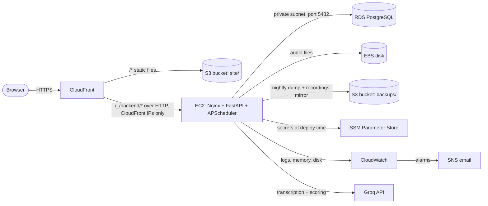

# Deploying DCM on AWS

The whole platform is described in one CloudFormation template, so it can be created with one
command and removed with another. Every service used is covered by the AWS Free Tier (or the
credits of the newer Free plan) at this project's size.



| Need | Service | Notes |
|---|---|---|
| HTTPS address for site and API | CloudFront | A small function sends React routes to `index.html`; API paths are never cached |
| React build | S3 (`site/`) | Bucket is private; only this CloudFront distribution may read it (Origin Access Control) |
| FastAPI, Nginx, scheduler | EC2 `t3.micro`, Ubuntu 24.04 | One uvicorn worker so the cleanup scheduler runs once; Elastic IP keeps the origin stable |
| Database | RDS PostgreSQL 16 `db.t3.micro` | Private subnets, no public IP, encrypted, daily automated backup |
| Network | VPC with public and private subnets | No NAT gateway (not free); the database never needs the internet |
| Secrets | SSM Parameter Store | Groq key, JWT secret, DB and admin passwords; written to `.env` on the server only |
| Server permissions | IAM role | Read/write its own bucket and read `/dcm/*` parameters; no access keys on the server |
| Shell access | SSM Session Manager | No SSH port is open |
| Logs and alarms | CloudWatch + SNS | Status check, CPU, DB storage and CloudFront 5xx alarms |
| Cost guard | AWS Budgets | $5 monthly budget with email alerts (skipped in Learner Lab) |

## Deploy

Prerequisites: AWS CLI v2 logged in (`aws configure`), Node.js, and a `backend/.env` with
`GROQ_API_KEY`. Commit your changes first: only committed backend code is shipped.

```powershell
./deploy/aws/deploy.ps1 -AlertEmail you@example.com
# AWS Academy Learner Lab: ./deploy/aws/deploy.ps1 -LearnerLab
```

The first run takes about 15-20 minutes. It prints the site URL and the admin email; the admin
password is generated and kept in Parameter Store (the script prints the command to read it).
Run the same command again to ship new code.

The deployment starts with an empty database. Log in as the admin and create HOD and employee
accounts from the Admin page.

## Remove everything

```powershell
./deploy/aws/destroy.ps1
```

This empties the bucket and deletes the stack, including the database and its data.
